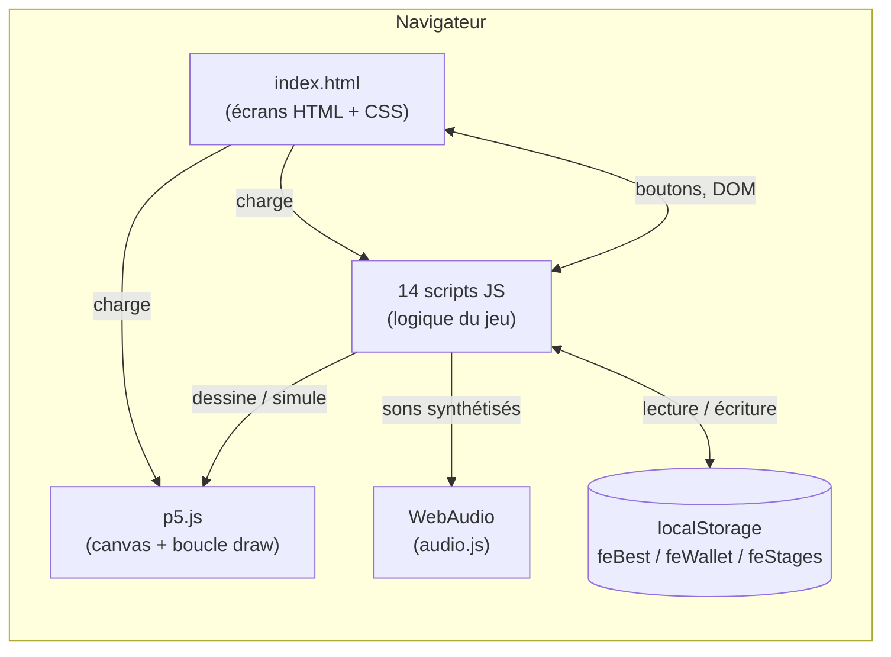
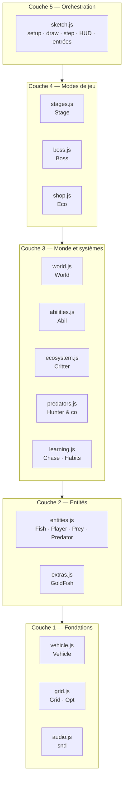
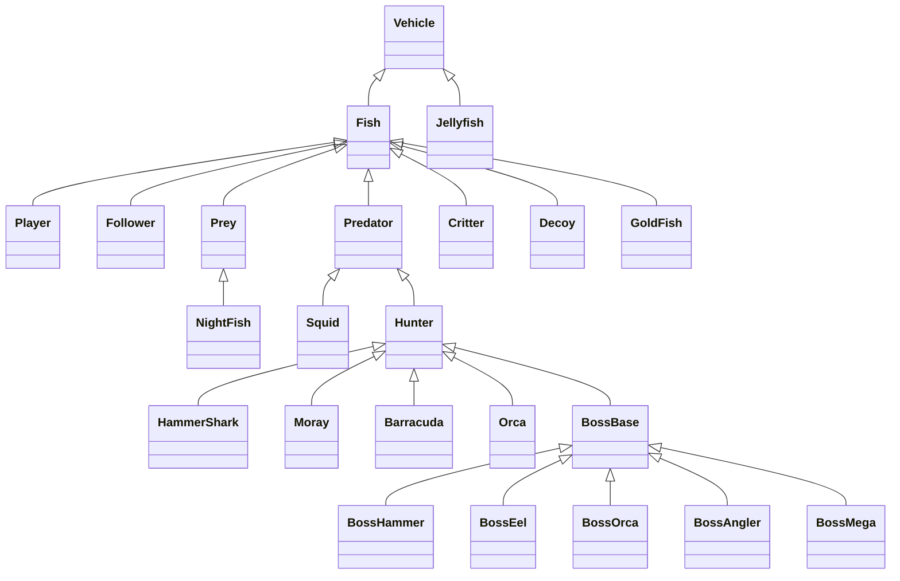
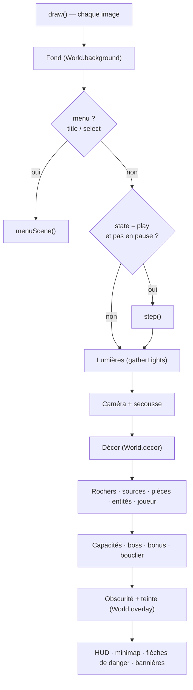
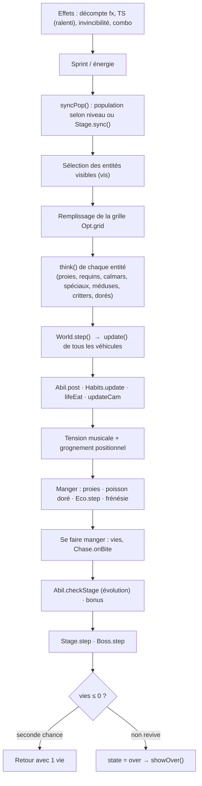
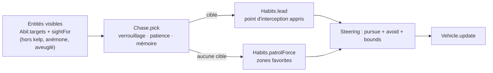
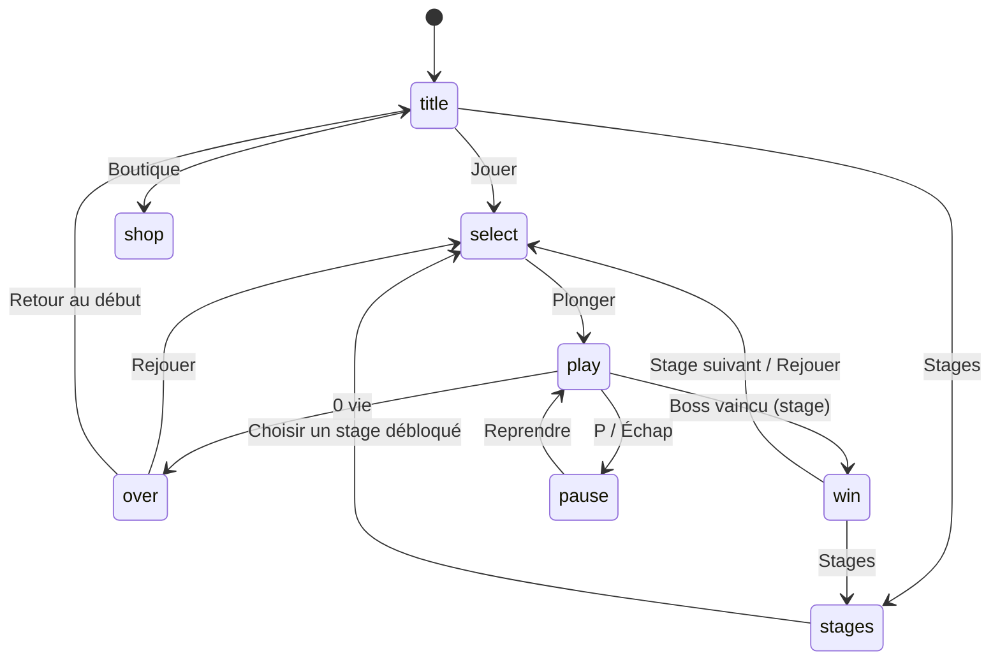
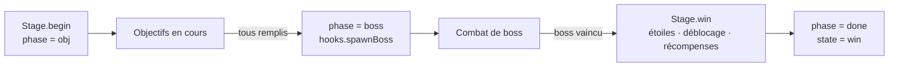

# Architecture — Fish Eat Fish : Deep Sea

**Auteure :** Hajar Belhachmi
**Objet :** décrire comment le projet est organisé : arborescence, technologies, modules, classes, flux de données, persistance.
**Source :** analyse du code de `Fish_version_28.zip` (dossier interne `Fish_version_6/Fish version_6`). Les chiffres (lignes, octets) sont ceux de l'archive.

---

## 1. Vue d'ensemble

Application **100 % front-end, sans serveur ni build** : une page `index.html` charge 14 scripts JavaScript classiques (pas de modules ES, pas de bundler) qui partagent un espace global. Le rendu du monde est dessiné sur un `<canvas>` par **p5.js** ; les menus sont du HTML/CSS superposé au canvas ; le son est synthétisé par **WebAudio** ; la progression est stockée dans **localStorage**.



---

## 2. Technologies

| Domaine | Technologie | Rôle dans le projet | Où |
|---|---|---|---|
| Langage | JavaScript (ES2015+, classes, fonctions fléchées) | Toute la logique | `*.js` |
| Rendu 2D | **p5.js** (≈ 1 Mo, version locale, repli CDN cdnjs 1.9.4) | Canvas, vecteurs `p5.Vector`, `createVector`, `random`, `map`, `lerp`, boucle `setup`/`draw` | `libraries/p5.min.js` |
| Interface | HTML5 + CSS3 (flexbox, grid, `clamp()`, `color-mix`, animations `@keyframes`, `backdrop-filter`, media queries) | Écrans : titre, sélection, stages, victoire, fin, pause, boutique | `index.html` |
| Graphismes UI | **SVG** généré en JS (`fishSVG`) | Cartes de poissons animées dans le carrousel | `sketch.js` |
| Audio | **WebAudio API** (oscillateurs, bruit blanc filtré, gain, panoramique stéréo, écho) | Effets, ambiance, musique adaptative — aucun fichier audio | `audio.js` |
| Persistance | **localStorage** (JSON) | Record, portefeuille/achats, progression des stages | `sketch.js`, `shop.js`, `stages.js` |
| IA | Comportements de pilotage (Reynolds), machines à états, carte de chaleur apprise | Proies, prédateurs, boss | `vehicle.js`, `learning.js`, `predators.js`, `boss.js` |
| Optimisation | Grille spatiale (spatial hash), cache, réutilisation d'objets, `Float32Array` | Fluidité avec centaines d'entités | `grid.js`, `learning.js` |
| Build / serveur | Aucun (ouvrir `index.html` suffit) | — | — |
| Tests | Aucun test automatisé ; debug via touche **D** et `?stage=&boss=1` | — | `sketch.js`, `boss.js` |

---

## 3. Arborescence du projet

```text
Fish_version_28.zip
└── Fish_version_6/
    └── Fish version_6/
        ├── index.html          (223 l.)  Écrans HTML, CSS, ordre de chargement des scripts
        ├── libraries/
        │   └── p5.min.js                 Bibliothèque p5.js (locale)
        │
        ├── sketch.js           (641 l.)  Chef d'orchestre : setup, draw, step, HUD, entrées, écrans
        │
        ├── vehicle.js           (86 l.)  Base de tout : Vehicle (steering behaviors)
        ├── grid.js              (27 l.)  Grille spatiale + objet Opt (optimisations)
        ├── entities.js         (472 l.)  Rendu des poissons, Obstacle, Fish, Player, Follower,
        │                                  Prey, Predator, Jellyfish, Squid, Vent
        ├── extras.js            (13 l.)  GoldFish (poisson doré)
        │
        ├── learning.js         (204 l.)  Chase (chasse persistante) + Habits (apprentissage)
        ├── predators.js        (286 l.)  Hunter, HammerShark, Moray, Barracuda, Orca + population
        ├── ecosystem.js        (131 l.)  Critter (poissons indépendants) + lifeThink/Eat/Spawn
        ├── abilities.js        (314 l.)  Évolution en 3 stades + capacités (Abil, Decoy)
        │
        ├── world.js            (442 l.)  World : biomes, jour/nuit, événements, décor, lumière
        ├── shop.js             (334 l.)  Eco : pièces, perles, améliorations, skins, objets
        ├── stages.js           (298 l.)  STAGES (5 cartes), objectifs, étoiles, progression
        ├── boss.js             (824 l.)  BossBase + 5 boss + gestionnaire Boss
        └── audio.js            (145 l.)  snd : moteur audio synthétisé
```

Poids du code (octets) :

| Fichier | Octets | Part |
|---|---:|---:|
| `boss.js` | 53 134 | 17 % |
| `sketch.js` | 52 335 | 17 % |
| `world.js` | 35 383 | 11 % |
| `entities.js` | 31 222 | 10 % |
| `shop.js` | 23 062 | 7 % |
| `stages.js` | 21 143 | 7 % |
| `index.html` | 20 675 | 7 % |
| `abilities.js` | 20 147 | 6 % |
| `predators.js` | 18 059 | 6 % |
| `audio.js` | 12 992 | 4 % |
| `learning.js` | 12 238 | 4 % |
| `ecosystem.js` | 7 748 | 2 % |
| `vehicle.js` | 4 802 | 2 % |
| `grid.js` + `extras.js` | 2 117 | 1 % |

---

## 4. Ordre de chargement et couches

Les scripts sont chargés dans cet ordre (chacun peut utiliser ce qui précède ; `sketch.js` est chargé en dernier et appelle tout le reste).

```text
 1  audio.js       ── moteur audio (snd)
 2  vehicle.js     ── Vehicle (+ variable globale TS)
 3  entities.js    ── Fish, Player, Prey, Predator…
 4  extras.js      ── GoldFish
 5  grid.js        ── Grid, Opt
 6  learning.js    ── Chase, Habits
 7  predators.js   ── Hunter, HammerShark, Moray, Barracuda, Orca
 8  ecosystem.js   ── Critter, lifeThink/lifeEat/syncLife
 9  abilities.js   ── Abil, Decoy, évolution
10  world.js       ── World
11  shop.js        ── Eco
12  stages.js      ── STAGES, Stage
13  boss.js        ── BossBase…BossMega, Boss   (s'accroche à Stage.hooks.spawnBoss)
14  sketch.js      ── setup(), draw(), step(), HUD, entrées, écrans
```



---

## 5. Hiérarchie des classes



Classes **hors hiérarchie** : `Obstacle`, `HiddenObstacle` (rochers), `Vent` (source hydrothermale), `Grid` (grille spatiale).

Arbre équivalent en texte :

```text
Vehicle                         (vehicle.js)
├── Jellyfish                   méduse
└── Fish                        (entities.js)
    ├── Player                  joueur
    ├── Follower                membre du banc du joueur
    ├── Decoy                   leurre de la capacité « banc de leurres »
    ├── GoldFish                poisson doré
    ├── Critter                 poisson indépendant (écosystème)
    ├── Prey                    proie en banc
    │   └── NightFish           poisson lumineux nocturne
    └── Predator                requin / baudroie
        ├── Squid               calmar
        └── Hunter              base des prédateurs spéciaux (predators.js)
            ├── HammerShark     requin-marteau (charge)
            ├── Moray           murène (embuscade)
            ├── Barracuda       banc de chasseurs
            ├── Orca            meute (encerclement)
            └── BossBase        base des boss (boss.js)
                ├── BossHammer  Récif
                ├── BossEel     Kelp
                ├── BossOrca    Épaves
                ├── BossAngler  Grotte
                └── BossMega    Abysses
```

---

## 6. Modules (objets globaux)

Hors classes, le code est structuré en **modules objets** (IIFE ou littéraux) qui exposent une petite API et gardent leur état interne.

| Module | Fichier | Type | Responsabilité | API principale (extraits) |
|---|---|---|---|---|
| `snd` | `audio.js` | IIFE | Audio synthétisé | `start`, `mute`, `vol`, `setMusic(profondeur, tension)`, `eat`, `growl`, `level`, `over`… |
| `Opt` | `grid.js` | littéral | Optimisations partagées | `grid`, `vents`, `crowd`, `CROWD`, `FAR` |
| `Chase` | `learning.js` | littéral | Chasse persistante | `pick`, `tire`, `onBite`, `reset` |
| `Habits` | `learning.js` | littéral | Apprentissage du joueur | `update`, `path`, `lead`, `patrolForce`, `debug`, `maturity` |
| `Abil` | `abilities.js` | littéral | Capacités + évolution | `use`, `press`, `step/post`, `targets`, `sightFor`, `hidden`, `checkStage`, `drawBack/Front` |
| `World` | `world.js` | IIFE | Environnement | `init(biome)`, `step`, `background`, `decor`, `overlay`, `hud`, `lights`, `inKelp`, `stages`, `off` |
| `Eco` | `shop.js` | IIFE | Économie | `onStart`, `step`, `preyDrop`, `bonus`, `owns`, `lv(id)`, `open/close`, `useItem`, `revive`, `save` |
| `Stage` | `stages.js` | IIFE | Mode Stages | `on`, `def`, `begin`, `step`, `sync`, `win`, `after`, `unlocked`, `stars`, `hooks.spawnBoss` |
| `Boss` | `boss.js` | littéral | Combat de boss | `spawn(i)`, `step`, `drawWorld`, `wave`, `shot`, `summon`, `alert`, `reset` |

**Seul couplage inversé :** `boss.js` écrit `Stage.hooks.spawnBoss = () => Boss.spawn(Stage.cur)`. `Stage` n'importe donc pas `Boss` : il appelle un crochet, qui reste `null` tant que `boss.js` n'est pas chargé.

---

## 7. Variables d'état globales (`sketch.js`)

| Groupe | Variables | Rôle |
|---|---|---|
| Machine à états | `state` (`title` / `select` / `play` / `over` / `win`), `paused`, `pick` | Écran courant, poisson choisi |
| Monde | `WW`, `WH`, `cam`, `showMap` | Taille du monde, caméra |
| Joueur | `player`, `followers`, `lives`, `inv`, `energy`, `boost`, `combo`, `comboT`, `level`, `score`, `eaten`, `maxDepth` | État de la partie |
| Entités | `preys`, `preds`, `squids`, `jellies`, `obstacles`, `vents`, `golds`, `pups`, `critters`*, `wild`** | Populations |
| Effets | `fx` (shield, turbo, frenzy, magnet, slow, double), `bubbles`, `snow`, `floats`, `shake`, `tension`, `TS`*** | Bonus et ambiance |
| Réglages | `P`, `CFG` | Paramètres modifiables (touche S) |
| Catalogues | `SPECIES`, `PREY`, `PRED`, `PRED_SQUID`, `PUPS` | Données statiques |

\* défini dans `ecosystem.js` · \*\* défini dans `predators.js` · \*\*\* défini dans `vehicle.js`

---

## 8. Boucle principale

p5.js appelle `draw()` à chaque image. `draw()` appelle `step()` (simulation) puis dessine, en couches, dans l'ordre.



### Contenu de `step()` (une image de simulation)



---

## 9. Pipeline de décision d'un prédateur



| Prédateur | Tactique | États |
|---|---|---|
| Requin / Baudroie | Poursuite simple, zone de profondeur | patrouille → chasse |
| Requin-marteau | Charge rectiligne | patrouille → alerte → charge → récupération |
| Murène | Embuscade dans un rocher | attente → contraction → détente → pause → retrait |
| Barracuda | Chasse en banc partagé | formation → poursuite commune |
| Orque | Meute | encerclement → attaque de tous côtés → replacement |
| Boss | 3 phases + vulnérabilité | rôde → annonce → attaque → vulnérable |

---

## 10. Règles de la chaîne alimentaire

```text
 Le plus gros mange le plus petit (rapport mini ≈ ×1,15 à ×1,25)

   Joueur ──mange──► Proies · Critters plus petits · Poisson doré
      │
      │ frénésie 🔥
      └──mange──► Prédateurs (sauf boss)

   Prédateurs ──mangent──► Joueur · Followers · Critters · Proies
   Critters gros ──mangent──► Critters petits · Proies
   Critters ──fuient──► tout ce qui est nettement plus gros (y compris le joueur)
```

---

## 11. Mode libre vs mode Stages

| Aspect | Mode libre | Mode Stages |
|---|---|---|
| Entrée | Bouton ▶ JOUER | Bouton 🗺 Stages (ou `?stage=`) |
| Variable | `Stage.cur = null` | `Stage.cur = 0..4` |
| Carte | 6 × 3 écrans, 5 biomes côte à côte | Un biome par carte (3,4×1,7 à 5×3 écrans) |
| Population | `syncPop` (réglages `P` + niveau) | `Stage.sync` (densités du stage) |
| But | Score, niveaux, record | Objectifs → boss → étoiles |
| Fin | 0 vie → écran de fin | Victoire (écran `win`) ou 0 vie |
| Persistance | `feBest` | `feStages` |



### Cycle d'un stage



---

## 12. Les 5 stages

| # | Clé | Nom | Boss | Objectifs | Seuils ★★ / ★★★ | Spécificités |
|---|---|---|---|---|---|---|
| 1 | `reef` | Récif corallien | Requin-marteau colossal | Manger 20 · devenir adulte | 1400 / 2200 | Calme, jour/nuit, tempête, tourbillon |
| 2 | `kelp` | Forêt de kelp | Murène géante | 3 perles · manger 30 | 1900 / 2900 | Algues qui cachent, murènes |
| 3 | `wreck` | Cimetière d'épaves | Orque géante | 3 coffres · 60 pièces | 2500 / 3700 | Barracudas, orques, épaves |
| 4 | `cave` | Grotte sous-marine | Baudroie géante | 4 perles · manger 35 | 2700 / 4000 | Noir, cristaux, calmars, éruptions |
| 5 | `abyss` | Fosse abyssale | Mégalodon | Devenir géant · 5 perles | 3200 / 4600 | Très sombre, difficulté maximale |

---

## 13. Poissons jouables

| Poisson | Accès | Capacité | Profil |
|---|---|---|---|
| Sardine | Gratuit | 🐟 Banc de leurres | Rapide, fragile |
| Poisson-clown | Gratuit | 🌺 Anémone refuge | Équilibré |
| Thon | Gratuit | 💥 Coup de queue | Gros, puissant |
| Lanterne | Gratuit | 💡 Flash | Brille en eau profonde |
| Poisson-ange | Perles (5) | 💡 Flash | Agile |
| Espadon | Perles (8) | 💥 Coup de queue | Rapide et massif |
| Mérou | Perles (12) | 🌺 Anémone refuge | Tank |
| Vipère | Perles (16) | 💡 Flash | Phosphorescente |

Évolution : **Alevin** (départ) → **Adulte** (≥ 25 % de la croissance : capacité débloquée) → **Géant** (≥ 65 % : capacité renforcée, recharge réduite).

---

## 14. Économie et persistance

### Données sauvegardées (localStorage)

| Clé | Écrit par | Contenu | Quand |
|---|---|---|---|
| `feBest` | `sketch.js` | Meilleur score du mode libre (nombre) | Fin de partie |
| `feWallet` | `shop.js` | `{ coins, pearls, up, fish, skins, skin, items }` | À chaque achat, `pagehide`, onglet masqué |
| `feStages` | `stages.js` | `{ stars[5], best[5] }` | Victoire d'un stage |

Tous les accès sont protégés par `try/catch` (navigation privée, stockage plein).

### Ressources

| Ressource | Source | Usage |
|---|---|---|
| 🪙 Pièces | Traînées dans l'océan, proies, coffres, poisson doré, victoires | Améliorations de base, skins, objets |
| Perles | Profondeur, coffres, prédateurs mangés en frénésie, étoiles gagnées | Poissons, améliorations rares, objets rares |

### Catalogue de la boutique

| Catégorie | Contenu | Stockage |
|---|---|---|
| Améliorations (11) | Vitesse, endurance, aimant, chasseur de trésors, poches pleines (pièces) · cœur, bouclier, capacités rapides, bonus prolongés, points, perles (perles) | `W.up[id]` = niveau |
| Poissons (4) | Poisson-ange, Espadon, Mérou, Vipère | `W.fish[nom]` |
| Skins (7) | Classique, Doré, Rubis, Émeraude, Améthyste, Néon, Fantôme | `W.skins`, `W.skin` |
| Objets (6) | Bulle, potion aimant, fiole turbo, parchemin ×2, sablier, seconde chance (max 9 chacun) | `W.items[id]` |
| Achats immédiats (3) | +1 vie, bouclier 8 s, frénésie 6 s | En partie seulement |

---

## 15. Interface : écrans HTML et canvas

Le canvas p5 occupe tout l'écran ; les écrans HTML sont des `<div class="screen">` superposés (`position: fixed`, `pointer-events: none` sauf sur les boutons) et affichés un à la fois par `showScreen(id)`.

| Élément (id) | État associé | Contenu |
|---|---|---|
| `#title` | `title` | Logo, slogan, Jouer / Stages / Boutique, touches |
| `#select` | `select` | Carrousel de poissons, option banc, Plonger |
| `#stages` | `title` | Liste des 5 stages (étoiles, cadenas) |
| `#winscr` | `win` | Boutons après victoire (le résumé est dessiné sur le canvas) |
| `#over` | `over` | Statistiques de la partie |
| `#pausemenu` | `play` + pause | Reprendre, réglages, volumes |
| `#shop` | tous | Boutique à onglets |
| `#panel` | tous | Sliders de réglage (touche S) |
| `#items` | `play` | Boutons d'objets (touches 1–5) |
| `#soundbtn` | tous | Mute (touche M) |
| `#err` | tous | Bandeau d'erreur ou d'audio bloqué |

### Raccourcis clavier / souris

| Entrée | Action |
|---|---|
| Souris | Nager vers le curseur |
| Espace ou clic | Sprint |
| E · Maj · clic droit | Capacité spéciale |
| 1 – 5 | Objets à usage unique |
| B | Boutique |
| P · Échap | Pause |
| M | Muet |
| N | Minimap |
| S | Panneau de réglages |
| D | Debug (forces, carte de chaleur, trajectoire prédite) |
| ← → | Naviguer dans la sélection |
| Entrée | Continuer (écran de victoire) |

Paramètres d'URL : `?stage=1..5` (ou `reef|kelp|wreck|cave|abyss`), `&boss=1` pour faire apparaître directement le boss.

---

## 16. Rendu : ordre des couches (de l'arrière vers l'avant)

```text
 1  Fond dégradé jour/nuit + parallaxe          World.background
 ── translate(-cam) : coordonnées du monde ──
 2  Décor (algues, coraux, épaves, cristaux)     World.decor
 3  Rochers, sources hydrothermales
 4  Capacités (arrière), pièces et perles        Abil.drawBack · Eco.draw
 5  Proies, critters, dorés, méduses, prédateurs,
    spéciaux, leurres, suiveurs
 6  Joueur (clignote si invincible)
 7  Capacités (avant), boss                      Abil.drawFront · Boss.drawWorld
 8  Bouclier, aimant, bonus qui tombent, bulles, textes flottants
 ── fin du translate ──
 9  Obscurité + teinte du biome + tempête        World.overlay
10  HUD, minimap, flèches de danger, bannières   hud · minimap · dangerArrows
```

---

## 17. Optimisation de la performance

| Technique | Où | Effet |
|---|---|---|
| Grille spatiale (cases 80 px) | `grid.js` → `Opt.grid` | Voisinage des proies en O(k) au lieu de O(n²) |
| Simulation limitée à l'écran (`vis`, marges 800–1300 px) | `sketch.js` | Seules les entités proches sont simulées |
| Dessin simplifié au-delà de 90 proies à l'écran | `Opt.CROWD` | Moins d'appels de dessin |
| Flocking 1 image sur 3 loin de l'écran | `Opt.FAR` | Moins de calculs hors champ |
| `steerXY`, vecteurs réutilisés (`a1`, `a2`, `Opt.zero`) | `vehicle.js` | Moins d'allocations / de ramasse-miettes |
| `Float32Array` pour la carte de chaleur | `learning.js` | Mémoire compacte, accès rapide |
| Trajectoire prédite calculée au plus une fois par image | `Habits.path` | Partagée entre tous les prédateurs |
| Cache d'obscurité et de couleurs | `sketch.js`, `entities.js` | Évite de recalculer à chaque image |
| Listes de menaces et sources calculées une fois par image | `step()` | Évite un `concat` par proie |

---

## 18. Points d'extension

| Pour ajouter… | Modifier |
|---|---|
| Un poisson jouable | `SPECIES` (`sketch.js`) + style dans `FSTYLE` (`entities.js`) |
| Une capacité | `ABIL` + `Abil.use` (`abilities.js`) |
| Un prédateur spécial | Nouvelle classe `extends Hunter` + `syncWild` (`predators.js`) |
| Un biome / stage | `STAGES`, `ECO_EXTRA` (`stages.js`) + `STG` (`world.js`) + boss dans `Boss.spawn` |
| Un type d'objectif | `OBJ_TYPES` (`stages.js`) |
| Un boss | Classe `extends BossBase` + ajout au tableau de `Boss.spawn` |
| Une amélioration / un objet | `UPS`, `ITEMS`, `SKINS` (`shop.js`) |
| Un bonus à ramasser | `PUPS` (`sketch.js`) + effet dans `step()` |
| Un son | Méthode dans l'objet retourné par `snd` (`audio.js`) |

---

## 19. Limites et choix d'architecture

- **Espace global partagé :** pas de modules ES ; les fichiers communiquent par variables et objets globaux. L'ordre de chargement est donc contraignant (voir §4).
- **Fichiers volumineux :** `sketch.js` (641 lignes très denses) et `boss.js` (824 lignes) concentrent beaucoup de logique.
- **Aucun test automatisé :** la vérification se fait en jouant, avec les raccourcis de debug.
- **Aucune dépendance serveur :** le jeu fonctionne hors ligne ; seul le repli de p5.js utilise un CDN si la copie locale manque.
- **Sauvegarde locale uniquement :** la progression est liée au navigateur et à l'appareil.
