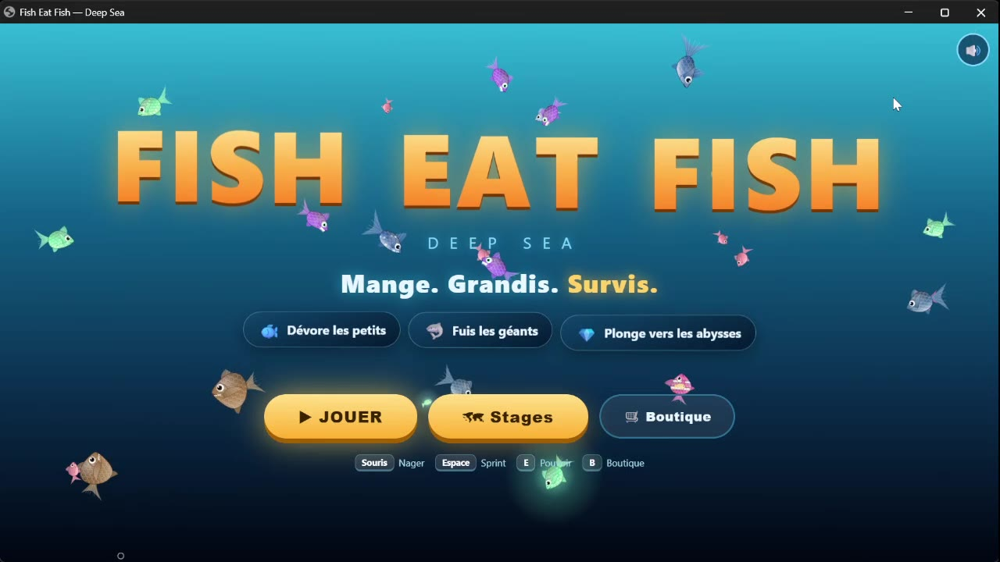
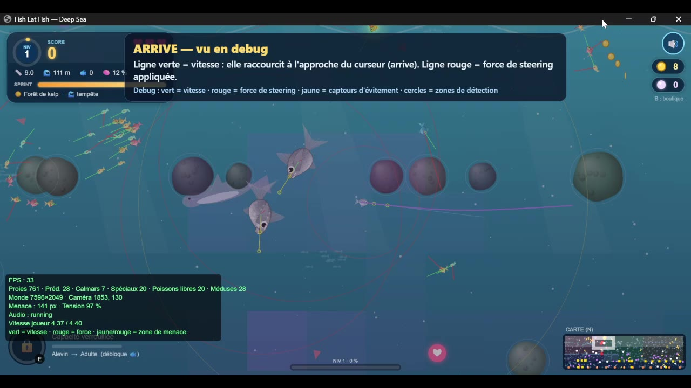
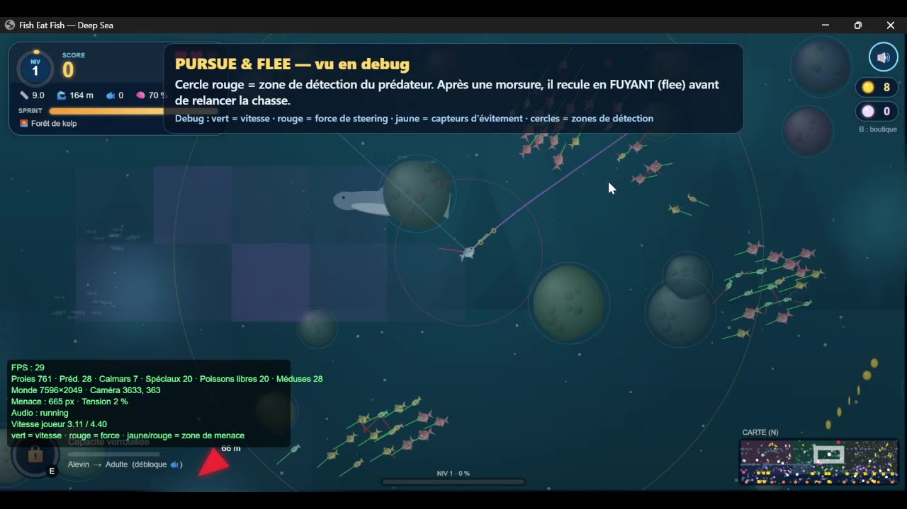
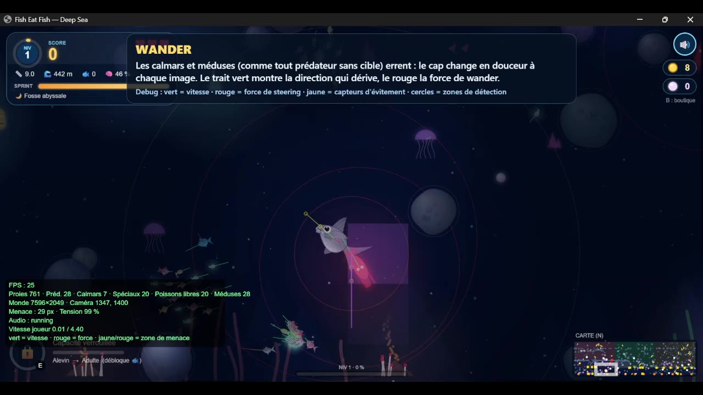
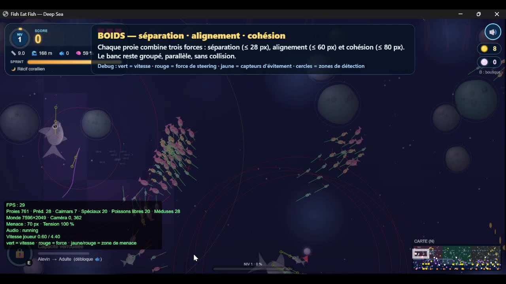
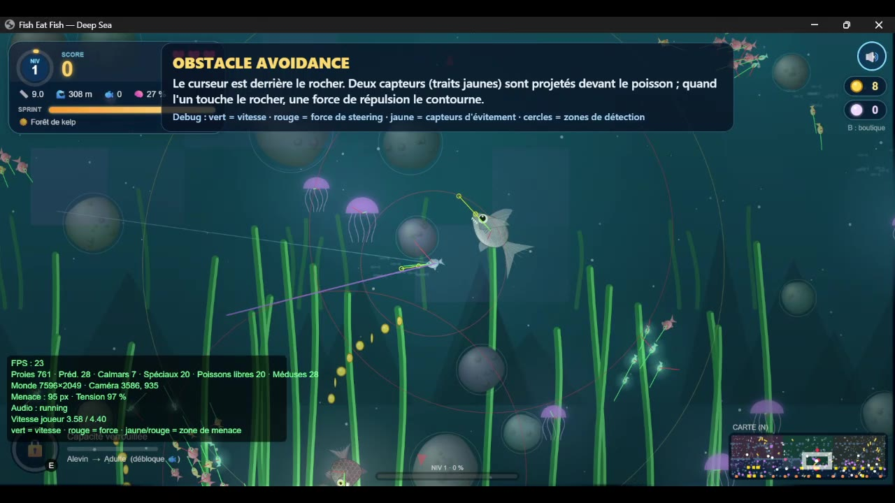
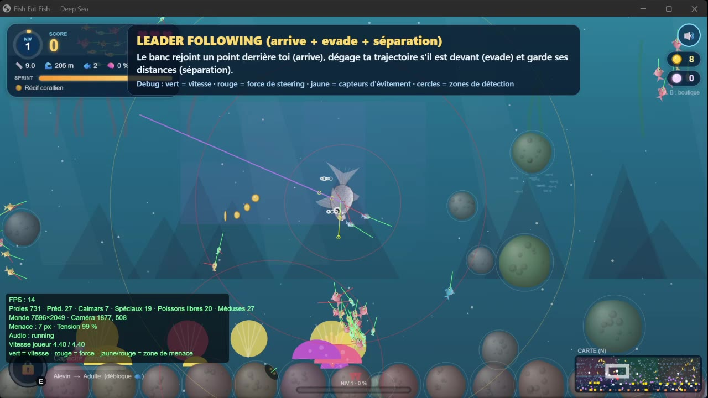
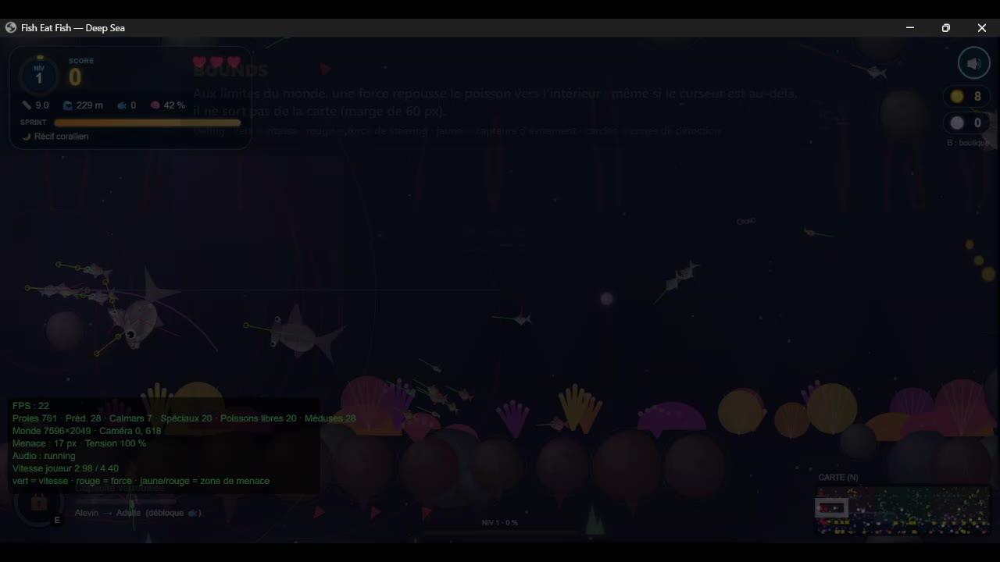
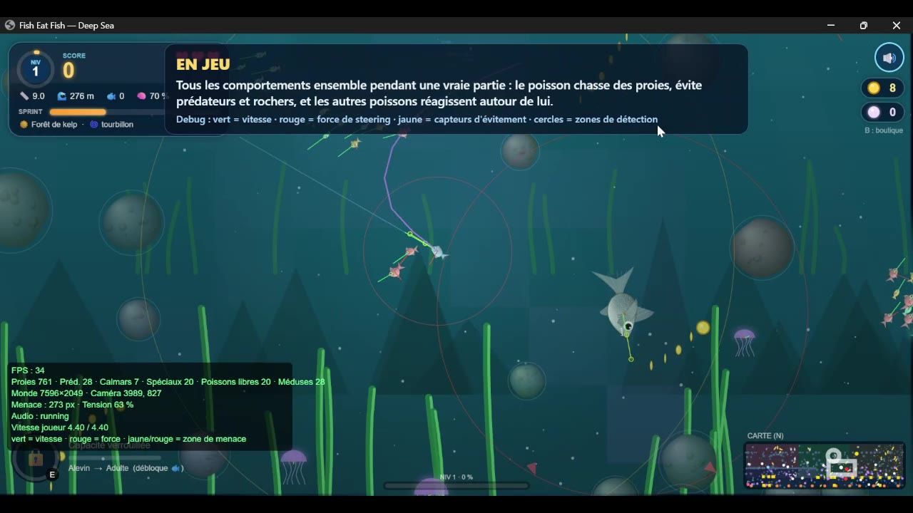
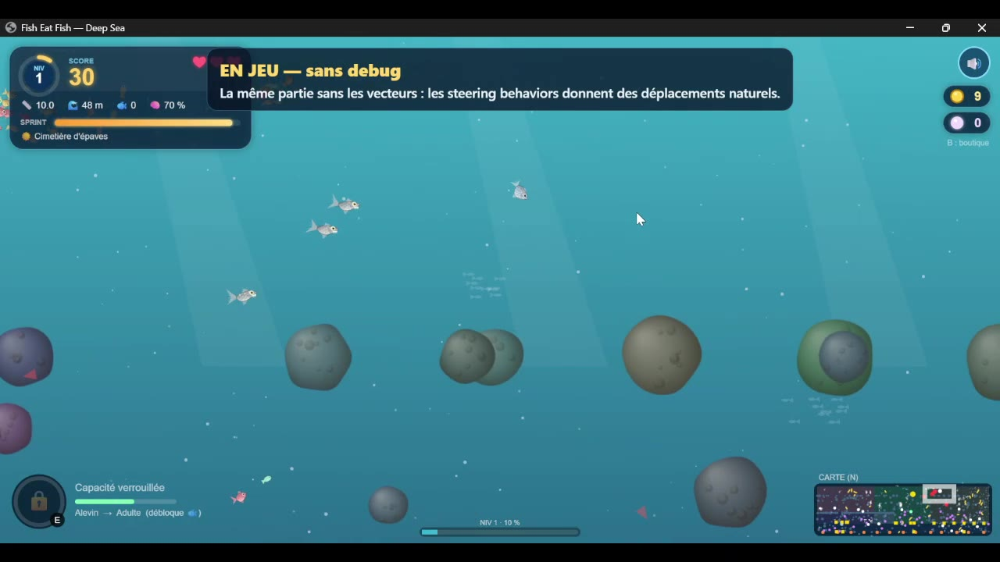

# 🐟 Fish Eat Fish — Deep Sea

### Jeu d'action sous-marin fondé sur les *Steering Behaviors* de Craig Reynolds, avec des prédateurs qui apprennent des habitudes du joueur

| | |
|---|---|
| **Réalisé par** | **HAJAR BELHACHMI** |
| **Formation** | Master IA2 — Université Côte d'Azur |
| **Année universitaire** | 2026 / 2027 |
| **Technologies** | JavaScript (ES6), p5.js, Canvas 2D, WebAudio API |
| **Type de projet** | Jeu web 2D, sans serveur, sans dépendance à installer |
| **Jeu en ligne** | [hajar0314.github.io/Fish_Eat_Fish](https://hajar0314.github.io/Fish_Eat_Fish/) |
| **Vidéo de démonstration** | [youtu.be/kVYHpWNMzbM](https://youtu.be/ee-cegjYU1M) |

---

## Démonstration en ligne

Le jeu peut être essayé directement dans le navigateur, sans installation : **[ouvrir Fish Eat Fish — Deep Sea](https://hajar0314.github.io/Fish_Eat_Fish/)**.

La vidéo ci-dessous présente les steering behaviors un par un, avec les vecteurs de debug (arrive, évitement d’obstacles, bounds, wander, flocage, evade, pursue et flee, suivi de leader), puis tous ensemble dans une vraie partie.

<p align="center"><a href="https://youtu.be/ee-cegjYU1M"></a><br><em>Cliquer sur l’image pour lancer la vidéo sur YouTube.</em></p>

---

## Table des matières

1. [Résumé](#1-résumé)
2. [Introduction](#2-introduction)
3. [Lancer le jeu et commandes](#3-lancer-le-jeu-et-commandes)
4. [Le jeu : principes et règles](#4-le-jeu--principes-et-règles)
5. [Architecture du projet](#5-architecture-du-projet)
6. [Explication détaillée de chaque fichier](#6-explication-détaillée-de-chaque-fichier)
7. [Les Steering Behaviors du projet](#7-les-steering-behaviors-du-projet)
8. [Comportements des entités : qui utilise quoi](#8-comportements-des-entités--qui-utilise-quoi)
9. [Apprentissage : des prédateurs qui s'adaptent](#9-apprentissage--des-prédateurs-qui-sadaptent)
10. [Les prédateurs spéciaux et les boss](#10-les-prédateurs-spéciaux-et-les-boss)
11. [Progression, économie et mode Stages](#11-progression-économie-et-mode-stages)
12. [Optimisations de performance](#12-optimisations-de-performance)
13. [Visualiser les steering behaviors (mode debug)](#13-visualiser-les-steering-behaviors-mode-debug)
14. [Conclusion](#14-conclusion)

---

## 1. Résumé

**Fish Eat Fish — Deep Sea** est un jeu d'action 2D se déroulant dans l'océan. Le joueur incarne un poisson qui suit la souris. Le principe tient en trois verbes : **manger** les poissons plus petits, **grandir**, **survivre** face aux plus gros. Au fil de la plongée, le joueur évolue (*Alevin → Adulte → Géant*), débloque une capacité spéciale propre à son espèce, récolte pièces et perles, améliore son poisson dans une boutique et affronte cinq boss, un par biome.

Techniquement, **tout le mouvement des poissons repose sur un seul moteur de pilotage autonome** : la classe `Vehicle` (`vehicle.js`), qui implémente les comportements de Craig Reynolds — *seek, flee, arrive, pursue, evade, wander, separate, align, cohesion, obstacle avoidance, leader following* et *bounds*. Chaque entité (joueur, banc, proies, requins, murènes, orques, boss…) n'est qu'une façon différente de **combiner et pondérer** ces forces.

Le projet ajoute une couche d'**apprentissage en ligne** (`learning.js`) : les prédateurs observent le joueur (zones fréquentées, direction habituelle de déplacement, côté d'esquive favori) et en tirent trois leçons pour mieux l'intercepter. Il ne s'agit pas d'un réseau de neurones, mais d'un modèle statistique léger (carte de chaleur, champ de vecteurs moyen, moyenne mobile exponentielle) qui rend le jeu de plus en plus difficile à mesure que le joueur répète ses habitudes.

**Chiffres clés** : 17 fichiers, environ 4 400 lignes de code applicatif (hors bibliothèque p5.js), 8 espèces jouables, 5 biomes, 5 boss, 8 bonus temporaires, 11 améliorations permanentes, 4 capacités spéciales, plus de 10 types de prédateurs et de poissons autonomes.

---

## 2. Introduction

### 2.1 Contexte

Ce projet a été réalisé dans le cadre du **Master IA2 de l'Université Côte d'Azur**. Il s'appuie sur le cours de comportements autonomes : les *steering behaviors* décrits par Craig Reynolds (« Steering Behaviors For Autonomous Characters », 1999) permettent de produire des mouvements crédibles, organiques et réactifs à partir de simples **forces** calculées à chaque image, sans scénario codé en dur ni calcul de chemin global.

### 2.2 Objectifs

- Concevoir un **jeu complet et jouable**, pas seulement une démonstration de comportements.
- Montrer que des **forces simples combinées** produisent des comportements riches : bancs, chasse en meute, encerclement, embuscade, fuite avec épuisement.
- Ajouter une **dimension d'intelligence adaptative** : les ennemis ne se contentent pas de réagir, ils *apprennent* du joueur.
- Rester **performant** avec plusieurs centaines d'entités simulées en temps réel dans un navigateur.
- Offrir une **expérience de jeu soignée** : rendu vectoriel animé, éclairage dynamique, musique adaptative synthétisée, boutique, progression, boss.

### 2.3 Principe de conception

Le projet suit une règle d'architecture simple : **une classe de base qui sait se déplacer** (`Vehicle`), une **classe qui sait se dessiner** (`Fish`), puis des classes spécialisées qui n'ont plus qu'à répondre à une seule question dans leur méthode `think()` : *« quelles forces dois-je appliquer maintenant, et avec quels poids ? »*

```
Vehicle  (vehicle.js)  → steering behaviors + intégration du mouvement
   └── Fish  (entities.js)  → rendu, bouche, nageoires, écailles
         ├── Player, Follower          → le joueur et son banc
         ├── Prey, NightFish, GoldFish → les proies
         ├── Critter                   → poissons indépendants (écosystème)
         ├── Decoy                     → leurres de la Sardine
         └── Predator                  → prédateur de base (requin, baudroie)
               ├── Squid               → calmar
               └── Hunter              → base des prédateurs spéciaux
                     ├── HammerShark, Moray, Barracuda, Orca
                     └── BossBase → BossHammer / BossEel / BossOrca / BossAngler / BossMega
```

---

## 3. Lancer le jeu et commandes

### 3.1 Lancement

Le projet est une page web statique. Deux options :

1. **Double-cliquer sur `index.html`** : le jeu démarre directement (p5.js est fourni localement dans `libraries/`, avec un repli automatique sur le CDN cdnjs).
2. **Recommandé** : lancer un petit serveur local, puis ouvrir `http://localhost:8000` :

```bash
cd "Fish version_6"
python3 -m http.server 8000
```

> Le jeu sauvegarde la boutique et la progression des stages dans le `localStorage` du navigateur (clés `feWallet` et `feStages`).


<p align="center"><br><em>Figure 1 — écran titre de Fish Eat Fish — Deep Sea (Jouer, Stages, Boutique).</em></p>

### 3.2 Commandes

| Action | Commande |
|---|---|
| Nager | **Souris** (le poisson *arrive* vers le curseur) |
| Sprint | **Espace** ou **clic gauche** (consomme l'énergie) |
| Capacité spéciale | **E**, **Maj** ou **clic droit** (ou bouton rond en bas à gauche) |
| Boutique | **B** |
| Objets à usage unique | **1** à **5** |
| Pause | **P** ou **Échap** |
| Réglages en direct (sliders) | **S** |
| Mode debug (steering, zones, apprentissage) | **D** |
| Minimap | **N** |
| Son | **M** |

Test rapide d'un boss : `index.html?stage=3&boss=1` lance directement le boss du stage 3.

---

## 4. Le jeu : principes et règles

### 4.1 La règle fondamentale

> **Le plus gros mange le plus petit.**

Un poisson peut en manger un autre si son rayon est supérieur d'au moins **15 %** (`f.r > p.r * 1.15`). Cette règle s'applique à tous : le joueur mange les proies, les poissons indépendants mangent les plus petits, les prédateurs mangent le joueur. Chaque proie avalée fait grandir le joueur (+0,35 de rayon, plafonné à 1,8 × la taille de départ de l'espèce) et rapporte 10 points.

### 4.2 Les modes de jeu

- **Mode libre** : océan continu, difficulté croissante par niveaux, objectif = battre son record de score.
- **Mode Stages** : 5 cartes (une par biome), chacune avec ses objectifs, son écosystème, son boss et un système d'étoiles (1★ = stage terminé, 2★ et 3★ selon le score final). Battre un stage débloque le suivant.

### 4.3 Les espèces jouables

Huit poissons, chacun avec sa taille, sa vitesse, sa maniabilité et **une capacité spéciale** :

| Espèce | Rôle | Capacité (touche E) |
|---|---|---|
| **Sardine** | Rapide, fragile | 🐟 *Banc de leurres* : des sardines factices attirent les prédateurs |
| **Poisson-clown** | Équilibré | 🌺 *Anémone refuge* : invisible et immunisé, les prédateurs sont piqués |
| **Thon** | Gros, puissant | 💥 *Coup de queue* : onde de choc qui repousse et étourdit |
| **Lanterne** | Brille en profondeur | 💡 *Flash aveuglant* : les prédateurs perdent la trace du joueur |
| **Poisson-ange** | Agile (boutique) | 💡 Flash aveuglant |
| **Espadon** | Rapide et massif (boutique) | 💥 Coup de queue |
| **Mérou** | « Tank » des récifs (boutique) | 🌺 Anémone refuge |
| **Vipère** | Chasseuse des abysses (boutique) | 💡 Flash aveuglant |

### 4.4 Évolution du poisson

La croissance détermine trois stades (`abilities.js`) :

| Stade | Seuil de croissance | Effet |
|---|---|---|
| **Alevin** | 0 % | Silhouette ronde, petites nageoires, pas de capacité |
| **Adulte** | 25 % | Capacité spéciale débloquée |
| **Géant** | 65 % | Capacité plus puissante, recharge plus rapide, aura dorée |

Chaque évolution déclenche une animation de « gonflement » et change réellement la silhouette dessinée (`stageStyle`).

### 4.5 Vies, énergie, bonus

- **3 vies** au départ (maximum 5). Après une morsure : 90 images d'invincibilité.
- **Énergie de sprint** (0 à 100) : le sprint multiplie la vitesse par 1,9 et consomme ; elle se régénère au repos.
- **8 bonus temporaires** qui tombent de la surface : 🛡 Bouclier, ⚡ Turbo, 🔥 Frénésie (permet de **manger les prédateurs**), 🧲 Aimant, ❤ +1 vie, ⏳ Ralenti (le monde ralentit, pas le joueur), ×2 Double score, 🐟 Clones (mini-banc allié).
- **Poisson doré** : rare, très rapide, il fuit le joueur ; vaut 150 points.
- **Combo** : manger vite enchaîne des multiplicateurs.

### 4.6 Le monde

- **5 biomes** : Récif corallien, Forêt de kelp, Cimetière d'épaves, Grotte sous-marine, Fosse abyssale, avec leur palette, leur obscurité et leurs événements.
- **Cycle jour / nuit** (7 200 images), poissons lumineux nocturnes, rayons de lumière, parallaxe, sources hydrothermales, épaves et coffres au trésor.
- **Obscurité en profondeur** : plus on descend, plus on voit mal, sauf avec un poisson lumineux. Les rochers sont **éclairés dynamiquement** par les poissons lumineux proches.

---

## 5. Architecture du projet

### 5.1 Arborescence

```
Fish version_6/
├── index.html          Interface HTML/CSS (menus) + ordre de chargement des scripts
├── sketch.js           Cœur du jeu : setup / draw / step, HUD, entrées, menus
├── vehicle.js          ⭐ Moteur de steering behaviors (classe Vehicle)
├── entities.js         Fish, Player, Follower, Prey, Predator, Jellyfish, Squid, rochers
├── predators.js        Requin-marteau, Murène, Barracuda, Orque (+ population)
├── ecosystem.js        Poissons indépendants (chaîne alimentaire complète)
├── learning.js         ⭐ Chasse persistante + apprentissage des habitudes du joueur
├── abilities.js        Évolution + capacités spéciales + leurres
├── boss.js             Les 5 boss et leurs attaques à phases
├── stages.js           Mode Stages : objectifs, étoiles, progression
├── world.js            Biomes, jour/nuit, événements, décor, coffres, épaves
├── shop.js             Économie : pièces, perles, boutique, sauvegarde
├── grid.js             Grille spatiale (optimisation du flocking)
├── audio.js            Moteur audio 100 % synthétisé (WebAudio)
├── extras.js           Poisson doré (GoldFish)
└── libraries/
    └── p5.min.js       Bibliothèque p5.js (dessin, vecteurs, utilitaires)
```

### 5.2 Boucle principale

À chaque image, `draw()` appelle `step()` (la simulation) puis dessine. La fonction `step()` (`sketch.js`) suit toujours cet ordre :

```
 1. Mise à jour des bonus, énergie, échelle de temps (TS)
 2. syncPop()            → maintient les populations (proies, prédateurs, méduses…)
 3. Sélection des entités « actives » (proches de l'écran, fonction vis())
 4. Remplissage de la grille spatiale (Opt.grid)
 5. think()              → CHAQUE entité calcule ses forces (steering behaviors)
 6. update()             → intégration : vel += acc ; pos += vel ; acc = 0
 7. Habits.update()      → le jeu observe le joueur (apprentissage)
 8. Collisions « qui mange qui » (proies, poisson doré, frénésie, morsures)
 9. Bonus, Stage.step(), Boss.step(), fin de partie
```

Cette séparation **penser → mettre à jour → résoudre les collisions** est essentielle : toutes les entités décident à partir du même état du monde, puis bougent ensemble.

---

## 6. Explication détaillée de chaque fichier

### `index.html` — Interface et chargement
Contient toute l'interface HTML/CSS : écran titre animé (logo lettre par lettre), sélection du poisson (carrousel avec évolution et capacité), choix des stages, écran de victoire, écran de fin, menu pause, **boutique** à onglets, bouton de son, barre d'objets et panneau de réglages. Charge p5.js (avec repli CDN) puis les scripts dans un ordre qui respecte les dépendances (`audio` → `vehicle` → `entities` → … → `sketch`). Un gestionnaire d'erreurs affiche en bas à gauche toute erreur JavaScript.

### `vehicle.js` (86 lignes) — ⭐ Le moteur de steering behaviors
Le fichier le plus important du projet. La classe `Vehicle` possède position, vitesse, accélération, `maxSpeed`, `maxForce`, et implémente **tous** les comportements : `seek`, `flee`, `arrive`, `pursue`, `evade`, `wander`, `separate`, `align`, `cohesion`, `avoid`, `followLeader`, `bounds`, ainsi que `steerXY` (version sans allocation pour l'optimisation) et `update()` (intégration, étourdissement, ralenti). Détaillé en section 7. Définit aussi `TS`, l'échelle de temps du monde.

### `entities.js` (472 lignes) — Les poissons et le rendu
- **Outils couleur** : `rgbOf` et `shade` (éclaircir / assombrir une couleur, mis en cache).
- **`FSTYLE` / `getStyle`** : style visuel par espèce (proportions, nageoires, dents, iris).
- **`fishPts` / `fishOutline` / `forScales`** : géométrie du corps (contour courbe, ondulation de nage, écailles décalées), partagée entre le canvas et les SVG des menus.
- **`Obstacle`** : rochers pré-rendus dans un sprite (relief, aspérités) puis **éclairés dynamiquement** par les sources de lumière (`LIGHTS`) avec un liseré lumineux.
- **`Fish`** : classe de rendu (dégradés, nageoires animées, bouche, lueur) héritant de `Vehicle`.
- **`Player`** : `think()` = `arrive(souris)` + `avoid` + `bounds`.
- **`Follower`** : membre du banc, `followLeader` + `avoid` + `bounds`.
- **`Prey`** : proies en banc (flocking via la grille, fuite, errance, attirance vers les sources hydrothermales).
- **`Predator`** : prédateur de base (requin, baudroie), utilise la chasse persistante.
- **`Jellyfish`** : méduse, obstacle mobile qui dérive, pulse et pique.
- **`Squid`** : calmar, embuscade puis jaillissement (*dash*).
- **`Vent`** : source hydrothermale qui attire les proies.

### `predators.js` (286 lignes) — Les prédateurs spéciaux
Quatre prédateurs, chacun avec une tactique propre, tous basés sur la classe `Hunter` :
- **🔨 `HammerShark`** : machine à états *patrouille → alerte (34 images) → charge rectiligne → récupération*.
- **🐍 `Moray`** (murène) : embusquée dans un rocher, jaillit à portée.
- **🐟 `Barracuda`** : chasse en **banc** (cohésion + alignement + poursuite partagée).
- **🐋 `Orca`** : chasse en **meute** (encerclement puis attaque coordonnée).

Contient aussi `syncWild()` / `syncPacks()` qui maintiennent les populations selon le niveau.

### `ecosystem.js` (131 lignes) — Vie sauvage indépendante
Des poissons **autonomes** (classe `Critter`) vivent leur propre vie, en trois tailles (petits en banc, moyens, gros). Règle unique : le plus gros mange le plus petit. Ils **fuient** (sprint, bulles de panique, épuisement progressif de l'endurance `sta`), **chassent** quand ils ont faim (`full` = rassasiement), **digèrent** après un repas, nagent en banc quand ils sont petits. Les prédateurs sans cible s'en prennent aussi à eux ; le joueur peut les manger. `lifeThink` / `lifeEat` / `syncLife` gèrent décision, repas et population.

### `learning.js` (204 lignes) — ⭐ Apprentissage
Deux modules : **`Chase`** (poursuite persistante avec patience, fatigue et abandon) et **`Habits`** (observation des habitudes du joueur : carte de courants, côté d'esquive, zones favorites). Détaillé en section 9.

### `abilities.js` (314 lignes) — Évolution et capacités
Définit les 4 capacités (`ABIL`), les stades d'évolution, `stageStyle` (silhouette par stade), `stunHunter` / `blindHunter` (effets sur les prédateurs), la classe `Decoy` (leurre), et l'objet `Abil` qui gère recharge, anneaux d'onde de choc, anémone, flash, `targets()` / `sightFor()` (ce que voient les prédateurs : le kelp et l'anémone cachent le joueur, les leurres sont prioritaires, l'aveuglement supprime toute vision).

### `boss.js` (824 lignes) — Les cinq boss
`BossBase` fournit barre de vie, **3 phases** (100 % → 66 % → 33 %), cycle *entrée → rôde → annonce (télégraphie) → attaque → vulnérable*. Cinq boss héritent : `BossHammer`, `BossEel`, `BossOrca`, `BossAngler`, `BossMega`. L'objet `Boss` gère contacts, projectiles, ondes de choc et récompenses. Les boss vivent dans le tableau `wild` comme les autres prédateurs : étourdissement, aveuglement, flèches de danger et tension musicale fonctionnent sans modification.

### `stages.js` (298 lignes) — Mode Stages
Tableau `STAGES` : 5 cartes avec objectifs (`eat`, `grow`, `pearls`, `coins`, `chests`), seuils d'étoiles, densités d'espèces, rochers, point de départ et boss. L'objet `Stage` suit les objectifs en jeu, déclenche le boss quand ils sont remplis, calcule le score final (score + bonus de vies + bonus de boss), attribue les étoiles et débloque le stage suivant (sauvegarde `localStorage`).

### `world.js` (442 lignes) — Le monde
Objet `World` : biomes et teintes, palette jour/nuit, événements, décor animé, parallaxe, épaves, coffres au trésor, kelp (qui **cache** les poissons), `NightFish` (poisson lumineux nocturne), `HiddenObstacle`, fond et assombrissement.

### `shop.js` (334 lignes) — Économie et boutique
Objet `Eco` : pièces 🪙 et perles, **11 améliorations permanentes** à niveaux et prix croissants (vitesse, endurance, aimant, chance, vie supplémentaire, bouclier de départ, recharge, durée des bonus, score…), **skins** cosmétiques, poissons à acheter, **objets** à usage unique (dont *Seconde chance*). Sauvegarde automatique dans le `localStorage`.

### `grid.js` (27 lignes) — Grille spatiale
Classe `Grid` (spatial hash à cases de 80 px) et objet `Opt` (paramètres d'optimisation). Détaillé en section 12.

### `audio.js` (145 lignes) — Audio synthétisé
Aucun fichier son : tout est généré par **WebAudio** (oscillateurs, bruit filtré). Effets (manger, morsure, sprint, croc), ambiance (vagues, bulles), **musique adaptative** qui monte en tension quand un prédateur approche, et **sons positionnels** (panoramique gauche/droite selon la position à l'écran).

### `extras.js` (13 lignes) — Poisson doré
`GoldFish` : poisson rare (rayon 8, vitesse 4,6, force 0,35) qui **évite** le joueur le plus proche (`evade` × 2 sous 300 px) sinon erre ; disparaît après 700 images ; vaut 150 points.

### `libraries/p5.min.js`
Bibliothèque p5.js : vecteurs (`p5.Vector`), dessin, `map`, `lerp`, `random`, boucle `setup`/`draw`.

---

## 7. Les Steering Behaviors du projet

Tout le moteur est dans `vehicle.js`. L'idée de Reynolds : à chaque image, un véhicule calcule une **force de pilotage** égale à la différence entre la vitesse **désirée** et la vitesse **actuelle**, limitée par `maxForce` :

```
steering = limit( desired − velocity , maxForce )
```

```js
steer(d, s = this.maxSpeed) { return d.setMag(s).sub(this.vel).limit(this.maxForce); }
```

Les forces sont **additionnées** (avec des poids) dans l'accélération, puis `update()` intègre : `vel += acc` (limitée à `maxSpeed`), `pos += vel`, `acc = 0`.

> `maxForce` détermine l'**agilité** : une sardine (0,28) vire serré, un thon (0,14) ou un requin (0,07) vire large. C'est ce qui rend chaque espèce différente à jouer.

### 7.1 Tableau récapitulatif

| Comportement | Méthode | Principe | Utilisé par |
|---|---|---|---|
| **Seek** | `seek(t)` | Vitesse désirée dirigée vers la cible | Base de presque tout |
| **Flee** | `flee(t)` | Opposé de seek | Recul d'un prédateur après morsure |
| **Arrive** | `arrive(t, d)` | Seek avec ralentissement progressif dans un rayon `d` | **Joueur** (souris, rayon 120), orques, vents, patrouille |
| **Pursue** | `pursue(o)` | Seek vers la **position future** (pos + vel × 10) | Tous les prédateurs |
| **Evade** | `evade(o)` | Opposé de pursue | Proies, poisson doré, poissons indépendants, `followLeader` |
| **Wander** | `wander()` | Errance par cercle devant le véhicule, avec mémoire | Proies, prédateurs sans cible, poisson doré |
| **Separation** | `separate(list, dist)` | Repousse les voisins trop proches (poids 1/d²) | Banc, meutes, prédateurs entre eux |
| **Alignment** | `align(list, dist)` | Adopte la vitesse moyenne des voisins | Proies, barracudas, orques |
| **Cohesion** | `cohesion(list, dist)` | Seek vers le centre de masse des voisins | Proies, barracudas, orques |
| **Obstacle avoidance** | `avoid(obs)` | Teste 2 points devant, fuit l'obstacle le plus menaçant | Toutes les entités |
| **Leader following** | `followLeader(...)` | Arrive derrière le leader, dégage sa trajectoire, sépare le groupe | Banc du joueur |
| **Bounds** | `bounds(...)` | Force de rappel près des bords de la carte | Toutes les entités |

### 7.2 Détail des comportements

**Seek / Flee**
```js
seek(t) { return this.steer(p5.Vector.sub(t, this.pos)); }
flee(t) { return this.seek(t).mult(-1); }
```

**Arrive** — le véhicule ralentit à l'approche pour s'arrêter sur la cible sans osciller. C'est le comportement du **joueur** : le poisson glisse naturellement vers le curseur et ralentit quand il l'atteint (rayon de ralentissement 120 px).
```js
arrive(t, d = 100) {
  const v = p5.Vector.sub(t, this.pos), m = v.mag();
  return this.steer(v, m < d ? map(m, 0, d, 0, this.maxSpeed) : this.maxSpeed);
}
```


<p align="center"><br><em>Figure 2 — comportement *arrive* en debug : la ligne verte est la vitesse, la ligne rouge la force de steering appliquée.</em></p>

**Pursue / Evade** — on ne vise pas où est la cible, mais où elle **sera** (10 images plus tard). Pour les prédateurs, la version de `Predator` (`aim()`) va plus loin : elle intègre ce que le jeu a **appris** du joueur (section 9).
```js
pursue(o) { return this.seek(p5.Vector.add(o.pos, o.vel.copy().mult(10))); }
evade(o)  { return this.pursue(o).mult(-1); }
```


<p align="center"><br><em>Figure 3 — *pursue* et *flee* en debug : le cercle rouge est la zone de détection du prédateur, qui recule après une morsure avant de relancer la chasse.</em></p>

**Wander** — un point cible est placé sur un petit cercle (rayon 30) à 60 px devant le poisson. Son angle dérive aléatoirement (`±0,35` par image) avec une **mémoire** (`wt × 0,95`), ce qui donne des trajectoires courbes et fluides plutôt que du bruit.
```js
wander() {
  this.wt = this.wt * 0.95 + random(-0.35, 0.35);
  const h = this.vel.heading() + this.wt;
  const c = this.vel.copy().setMag(60).add(this.pos);
  return this.seek(createVector(c.x + 30 * cos(h), c.y + 30 * sin(h)));
}
```


<p align="center"><br><em>Figure 4 — *wander* : le trait vert montre la direction qui dérive, le rouge la force d’errance.</em></p>

**Separation** — chaque voisin trop proche pousse avec une force en **1/d²** : plus il est près, plus la répulsion est forte.
```js
s.add(p5.Vector.sub(this.pos, o.pos).div(d * d));
```

**Alignment / Cohesion** — le véhicule moyenne la vitesse (alignement) ou la position (cohésion) des voisins dans un rayon (60 px et 80 px par défaut). Ensemble avec la séparation, ces trois règles forment le **flocking** (bancs de Boids).


<p align="center"><br><em>Figure 5 — flocage (séparation ≤ 28 px, alignement ≤ 60 px, cohésion ≤ 80 px) : le banc reste groupé, parallèle et sans collision.</em></p>

**Obstacle avoidance** — version « deux points » : on projette deux points devant le poisson (à `lookAhead` et `lookAhead / 2`). Si un de ces points (ou la position actuelle) pénètre dans un obstacle, on dirige le poisson loin de lui, avec un poids ×2,5. On ne retient que l'obstacle **le plus menaçant**. Un test de proximité rapide élimine les obstacles lointains avant tout calcul.
```js
a1.set(px + ux * la, py + uy * la);   // point à lookAhead
a2.set(px + ux * la / 2, py + uy * la / 2);  // point à mi-chemin
// ... on garde l'obstacle dont la distance min (pos, a1, a2) est la plus petite
return this.steer(p5.Vector.sub(a1, best.pos)).mult(2.5);
```


<p align="center"><br><em>Figure 6 — évitement d’obstacles : deux capteurs (traits jaunes) projetés devant le poisson ; au contact d’un rocher, une force de répulsion le contourne.</em></p>

**Leader following** — chaque membre du banc : (1) *arrive* à un point situé **derrière** le leader, (2) s'il se trouve dans la trajectoire du leader (devant lui), il l'**évite** pour dégager le passage, (3) se **sépare** des autres membres.
```js
followLeader(leader, group, behind = 45) {
  const back  = leader.pos − unit(leader.vel) × behind;
  const front = leader.pos + unit(leader.vel) × behind × 1.2;
  const f = this.arrive(back, 70);
  if (près de front ou trop près du leader) f.add(this.evade(leader).mult(1.5));
  return f.add(this.separate(group, this.r * 3).mult(P.sepW));
}
```


<p align="center"><br><em>Figure 7 — suivi de leader : le banc rejoint un point derrière le joueur (*arrive*), dégage sa trajectoire (*evade*) et garde ses distances (séparation).</em></p>

**Bounds** — dès que le poisson entre dans une marge de 60 px du bord, une force le repousse vers l'intérieur (poids ×2). Les limites verticales varient selon l'espèce (certains prédateurs ne vivent qu'en profondeur).


<p align="center"><br><em>Figure 8 — *bounds* : près du bord de la carte, une force repousse le poisson vers l’intérieur (marge de 60 px).</em></p>

### 7.3 Poids ajustables en direct

Tous les poids sont stockés dans l'objet `P` et modifiables **en jeu** avec la touche **S** : poids d'évitement, de séparation, d'alignement, de cohésion, distance d'anticipation, rayon de détection des prédateurs, nombre de chaque espèce, persévérance de chasse, intensité de l'apprentissage… Cela permet d'observer immédiatement l'effet de chaque force sur le comportement collectif.

---

## 8. Comportements des entités : qui utilise quoi

### 8.1 Le joueur et son banc

```
Player   : arrive(souris, 120) + avoid × avoidW + bounds
Follower : followLeader(player, group) + avoid × avoidW + bounds
```
Pendant un sprint, `maxSpeed` est multiplié par 1,9 et `maxForce` par 2,2 : le poisson accélère *et* vire plus serré.

### 8.2 Les proies (`Prey`) — le banc

Combinaison de **sept forces** :

| Force | Effet |
|---|---|
| Séparation (28 px) × `sepW` | Ne pas se superposer |
| Alignement (60 px) × `aliW` | Nager dans la même direction |
| Cohésion (80 px) × `cohW` | Rester groupé |
| `evade` × 2,5 d'un prédateur à moins de 0,6 × `detect` | **Panique** |
| `evade` × 3 d'un poisson plus gros (joueur, banc) | Fuir le joueur s'il est plus gros |
| `wander` × 0,4 | Errance de fond |
| `arrive` vers une source hydrothermale × 0,6 | Attirance vers la nourriture |
| + `avoid` et `bounds` | Rochers, méduses, bords |

C'est de la **superposition de comportements** : un banc qui s'écarte devant un requin, se reforme derrière lui, contourne un rocher, et dérive vers un évent, sans qu'aucune règle ne décrive ce résultat global.

### 8.3 Les prédateurs

| Prédateur | Forces principales | Particularité |
|---|---|---|
| **Requin / Baudroie** (`Predator`) | `pursue` × 1,2 ou `wander`, `separate` × 1,5, `avoid` × 1,3 | Baudroie : ne chasse qu'en profondeur (`deep()`) |
| **Calmar** (`Squid`) | Comme `Predator` + *dash* | À < 70 % de la détection : vitesse × 2,6 et force 0,25 pendant 40 images, puis recharge 200 |
| **Requin-marteau** | `pursue` × 0,8 ; états alerte / charge | Pendant la charge, la **direction est verrouillée** : on l'esquive en virant sur le côté |
| **Murène** | Aucune force : mouvement scripté dans un rocher | Vise la **position future** du joueur (`aim`) |
| **Barracuda** | `pursue` × 1,3, `align` × 0,5 ; sinon `cohesion` + `align` + `wander` | Si un membre voit une proie, **tout le banc** la poursuit (`shared`) |
| **Orque** | `arrive` sur un cercle autour de la proie, puis `pursue` × 1,4 | **Encerclement** puis **vagues d'attaque** coordonnées |
| **Poisson indépendant** (`Critter`) | `evade` × 3 (fuite), `pursue` × 1,2 (chasse), `wander`, flocking | Endurance de sprint, rassasiement, digestion |
| **Poisson doré** | `evade` × 2 du joueur, sinon `wander` | Rapide (4,6) et très maniable (0,35) |

### 8.4 Détails des machines à états

**Requin-marteau** :
```
 patrouille ──(cible à < 0,8 × detect, cool = 0)──► ALERTE (34 images, vitesse × 0,35, anneau rouge + « ! »)
      ▲                                                  │
      │                                                  ▼
  récupération (cool 280) ◄──────────────── CHARGE (52 images, vitesse × 3, direction verrouillée)
```

**Orque (meute)** :
```
 phase 1 : ENCERCLEMENT   chaque orque arrive à sa place sur un cercle (330 × 230 px) autour de la proie
      │   quand ≥ 60 % de la meute est à < 480 px et que le délai est écoulé
      ▼
 phase 2 : ATTAQUE        170 images, pursue × 1,4 de tous les côtés (rugissement)
      │
      ▼
 la meute se replace (cool 140) → nouvelle vague
```

---

## 9. Apprentissage : des prédateurs qui s'adaptent

> **Précision importante** : il ne s'agit pas d'apprentissage profond ni d'un réseau de neurones. C'est de l'**apprentissage en ligne** à base de **statistiques incrémentales** : le jeu mesure le comportement du joueur pendant la partie et ajuste le comportement des ennemis. Les modèles sont légers, interprétables et visualisables (touche **D**).

### 9.1 Module `Chase` — la chasse persistante

**Problème de départ** : un prédateur qui lâche sa proie dès qu'elle sort du cercle de détection est trop facile à semer. **Solution** : une machine à états avec patience, fatigue et mémoire.

| Mécanisme | Fonctionnement |
|---|---|
| **Verrouillage** | Une fois la proie choisie (la plus proche dans le cercle), le prédateur la garde. |
| **Patience** | ≈ 9 s (540 images), +3 % par niveau (jusqu'au niveau 10). Elle s'épuise **2,2 × plus vite** quand la proie est hors du cercle de détection. |
| **Dernière position connue** | Si la proie disparaît (kelp, anémone, leurre), le prédateur file vers l'endroit où il l'a vue pour la dernière fois (une « cible fantôme »), puis abandonne. |
| **Fatigue** | En fin de chasse, la vitesse maximale baisse jusqu'à **−18 %** (`Chase.tire`). |
| **Changement de cible** | Si une autre cible est nettement plus proche (< 60 % de la distance), il la prend. |
| **Repos** | Après abandon, pause de 200 à 260 images pendant laquelle il ne réagit qu'à une proie très proche. |
| **Laisse** | Au-delà de `detect × leash` (2,2 par défaut), il abandonne. |

**Garde-fous d'équité** (pour que le jeu reste jouable) :
- le nombre de poursuivants « lointains » simultanés est **plafonné** : `min(4, 2 + niveau / 4)` ;
- après une morsure, le prédateur qui a mordu **recule** (40 images), se calme (160) et se repose (330) ; les prédateurs à moins de 700 px se calment aussi quelques secondes (`Chase.onBite`) : c'est la « miséricorde ».

### 9.2 Module `Habits` — l'observation du joueur

`Habits.update()` est appelé **une fois par image**. Le jeu mémorise trois choses sur une grille de cases de 110 px :

| Leçon | Structure de données | Ce que les prédateurs en font |
|---|---|---|
| **1. Carte de courants** | `fx`, `fy`, `fw` : somme des directions unitaires du joueur par case | *« Quand il passe ici, il va en général par là »* → **trajectoire prédite** sur 90 images |
| **2. Côté d'esquive favori** | `dodge` : moyenne mobile exponentielle (α = 0,02) du côté vers lequel le joueur vire quand on le charge | Le tir est **décalé** perpendiculairement, du côté où il esquive d'habitude |
| **3. Zones favorites** | `heat` : carte de chaleur (cases visitées) | Les prédateurs **sans cible** rôdent là où le joueur aime aller (tirage pondéré, point conservé ~3 s) |

**Maturité** : rien n'est appris au début. La confiance monte de 0 à 100 % en environ une minute de jeu :

```js
get maturity() { return clamp((this.n - 600) / 3000, 0, 1); }  // 0 pendant ~10 s, 100 % après ~1 min
```

Le niveau effectif d'apprentissage est `L = P.learn × maturity` (`P.learn` = 0,7 par défaut, réglable de 0 à 1 ; à 0 les prédateurs n'apprennent rien). Un message « 🧠 *Les prédateurs étudient tes habitudes…* » s'affiche quand la maturité dépasse 35 %.

**Oubli** : toutes les 60 mises à jour, les mémoires sont multipliées par 0,98 (demi-vie ≈ 35 s). Le joueur peut donc **changer de stratégie** : les anciennes habitudes s'effacent, et les prédateurs réapprennent.

### 9.3 La trajectoire prédite (`Habits.path`)

La trajectoire du joueur est simulée sur **9 pas de 10 images** (90 images au total) à partir de sa position et de sa vitesse. À chaque pas :
1. on lit la direction habituelle autour du point (moyenne pondérée des 9 cases voisines, la case centrale comptant double) ;
2. on mesure sa **cohérence** `c` (1 = toujours la même direction) ;
3. on **mélange** la direction courante et la direction apprise : `v = v × (1 − c) + flux × c`, avec `c ≤ 0,85`.

Un joueur prévisible (il fait toujours le même circuit) donne des trajectoires cohérentes, donc des prédateurs qui interceptent avec précision. Un joueur imprévisible donne une cohérence faible, et la prédiction retombe sur l'extrapolation linéaire classique.

### 9.4 Le tir anticipé (`Habits.lead`)

Quand un chasseur vise le joueur, `aim()` calcule d'abord l'extrapolation linéaire (`pos + vel × k`), puis `Habits.lead()` la corrige :
- temps d'interception estimé `t = distance / vitesse` (borné entre 8 et 85 images) ;
- point prédit sur la trajectoire apprise à cet instant ;
- **correction** = écart entre ce point et la ligne droite (plafonnée à 220 px) ;
- **décalage latéral** selon le côté d'esquive favori ;
- au contact (distance < `r joueur + r prédateur + 40`), poursuite directe.

> Résultat : un joueur qui esquive toujours à gauche finit par se faire intercepter à gauche. Il doit **varier** ses esquives.

### 9.5 Pourquoi cette approche est pertinente

- **Aucune donnée d'entraînement** : l'apprentissage se fait *pendant* la partie, par le joueur lui-même.
- **Coût négligeable** : mise à jour O(1) par image, prédiction O(9) au plus une fois par image (mise en cache avec `_pf`).
- **Explicable** : tout est visible avec la touche D (carte de chaleur violette + trajectoire prédite).
- **Équilibrée** : la maturité progressive, l'oubli et les garde-fous évitent un jeu injuste.

---

## 10. Les prédateurs spéciaux et les boss

### 10.1 Les cinq boss

Un boss apparaît quand les objectifs du stage sont remplis. Tous suivent le même cycle :

```
 entrée → rôde → ANNONCE (texte + télégraphie) → ATTAQUE → VULNÉRABLE → rôde …
```

- **3 phases** (100 % → 66 % → 33 % de vie) : attaques plus nombreuses et plus rapides.
- **Fenêtre de vulnérabilité** après chaque grosse attaque : c'est le seul moment où l'on peut le mordre (dégâts plus forts quand on a évolué). Hors fenêtre, toucher un boss coûte une vie.
- Le bonus **🔥 Frénésie** blesse le boss au contact, même hors fenêtre.

| Stage | Boss | Attaques |
|---|---|---|
| 🪸 Récif | **Requin-marteau colossal** | Charges (simple, double, triple), séisme |
| 🌿 Kelp | **Murène géante** | Embuscade surgissant d'en dessous, crachats d'acide |
| ⚓ Épaves | **Orque géante** | Sonar (ondes), meute invoquée, éperonnage |
| 💎 Grotte | **Baudroie géante** | Leurre qui **attire** le joueur, lueurs téléguidées, élan |
| 🌌 Abysses | **Mégalodon** | Charges en série, rugissements (ondes qui vident le sprint) |

Les boss héritent de `Hunter` et utilisent les mêmes steering behaviors que les prédateurs classiques (charges = `applyForce` dans une direction verrouillée, comme le requin-marteau, mais à plus grande échelle).

### 10.2 Interactions entre capacités et prédateurs

Le système de **vision** (`Abil.sightFor`) montre bien la modularité :
- *Banc de leurres* → les prédateurs qui voient un leurre à moins de `detect` **ignorent le joueur** et poursuivent les leurres.
- *Flash* → `blind > 0` : le prédateur ne voit **rien** (liste vide) et perd sa cible (`Chase.pick` → `drop`).
- *Anémone* → le joueur est exclu des cibles visibles et devient intouchable.
- *Coup de queue* → `stunHunter` : accélération annulée, le prédateur dérive avec `vel × 0,9`.
- *Kelp* → cache aussi les poissons (`World.inKelp`).

---

## 11. Progression, économie et mode Stages

### 11.1 Les stages

| # | Stage | Objectifs | Étoiles (2★ / 3★) |
|---|---|---|---|
| 1 | 🪸 Récif corallien | Manger 20 poissons · Devenir adulte | 1 400 / 2 200 |
| 2 | 🌿 Forêt de kelp | Trouver 3 perles · Manger 30 poissons | 1 900 / 2 900 |
| 3 | ⚓ Cimetière d'épaves | Ouvrir 3 coffres · Ramasser 60 pièces | 2 500 / 3 700 |
| 4 | 💎 Grotte sous-marine | Trouver 4 perles · Manger 35 poissons | 2 700 / 4 000 |
| 5 | 🌌 Fosse abyssale | Devenir géant · Trouver 5 perles | 3 200 / 4 600 |

Score final = score de la partie + bonus de vies restantes (150 par vie) + bonus de boss. Chaque stage a sa propre densité d'espèces, ce qui change réellement la façon de jouer (par exemple, des meutes d'orques dans les épaves, des calmars dans la grotte).

### 11.2 Économie

- **Pièces 🪙** : traînées dans l'océan, lâchées par certaines proies, les coffres, le poisson doré.
- **Perles** : rares, cachées en profondeur, dans les coffres ou sur les prédateurs mangés en frénésie.
- **Améliorations permanentes** : vitesse, endurance, aimant, chasse au trésor, valeur des pièces, vies de départ, bouclier de départ, capacités rapides, bonus prolongés, score, perles.
- **Sauvegarde** dans le `localStorage` : portefeuille, améliorations, skins, progression des stages.

---

## 12. Optimisations de performance

Le jeu simule plusieurs centaines d'entités dans le navigateur. Les optimisations suivantes le rendent fluide :

| Optimisation | Fichier | Principe |
|---|---|---|
| **Grille spatiale** (spatial hash, cases de 80 px) | `grid.js`, `Prey.flockGrid` | Une proie ne regarde que sa case + 8 voisines au lieu de toutes les proies : on passe de **O(n²)** à O(n) |
| **Simulation locale** | `vis()` dans `sketch.js` | Seules les entités proches de l'écran sont simulées (800 à 1 300 px selon le type) |
| **Flocking espacé** | `Opt.FAR = 250` | Hors écran, le flocking n'est recalculé qu'**une image sur 3**, la dernière force est réutilisée |
| **Zéro allocation** | `steerXY`, `avoid` (vecteurs réutilisés) | Évite la création de milliers de `p5.Vector` par image (ramasse-miettes) |
| **Dessin simplifié** | `Opt.crowd`, `Opt.CROWD = 90` | Au-delà de 90 proies à l'écran, rendu allégé |
| **Sprites pré-rendus** | `Obstacle.bake()` | Chaque rocher est dessiné une fois dans un canvas hors écran |
| **Caches** | `rgbOf`, `shade`, `getStyle` | Couleurs et styles calculés une seule fois |
| **Calculs partagés** | `step()` | Listes de menaces et d'évents calculées **une fois** par image |
| **Population dynamique** | `syncPop`, `syncLife`, `syncWild` | Le nombre d'entités s'adapte à la taille de l'écran (`A()`) et au niveau |

---

## 13. Visualiser les steering behaviors (mode debug)

Appuyer sur **D** active l'affichage de debug, à utiliser pour **montrer les steering behaviors en action** :

| Élément affiché | Ce qu'il illustre |
|---|---|
| **Ligne jaune + 2 petits cercles** devant chaque poisson | Les deux points « ahead » de l'*obstacle avoidance* (`Fish.debug`) |
| **Cercle rouge** autour de chaque prédateur | Rayon de détection (`P.detect`) |
| **Cercle rouge de 400 px** autour de chaque murène | Zone de déclenchement de l'embuscade |
| **Carte de chaleur violette** | Cases fréquentées par le joueur (`Habits.heat`) |
| **Ligne violette brisée** | Trajectoire prédite du joueur (`Habits.path`) |
| **Panneau debug** (HUD) | Valeurs en direct (`debugHud`) |

Avec le panneau de réglages (**S**), on peut **isoler** chaque comportement pour le démontrer :

| Pour observer… | Réglage |
|---|---|
| Le flocking pur | Mettre prédateurs à 0, jouer avec **Poids séparation / alignement / cohésion** |
| L'évitement d'obstacles | Faire varier **Poids évitement** et **Distance d'anticipation** |
| Le *pursue* seul | Un seul prédateur, **Apprentissage = 0** |
| L'apprentissage | **Apprentissage = 1**, répéter le même parcours, observer la ligne violette |
| La chasse en groupe | Augmenter **Bancs de barracudas** / **Meutes d'orques** |
| La persévérance | Faire varier **Persévérance de chasse ×** |


<p align="center"><br><em>Figure 9 — tous les comportements ensemble pendant une partie, avec le mode debug (**D**) activé.</em></p>

<p align="center"><br><em>Figure 10 — la même partie sans les vecteurs : les steering behaviors produisent des déplacements naturels.</em></p>

### Scénario de démonstration conseillé (3 minutes)

1. **Flocking** : lancer une partie en mode libre, observer le banc de proies qui se disperse puis se reforme autour du joueur.
2. **Seek / Arrive / Avoid** : bouger la souris près d'un rocher, activer **D** et voir les points d'anticipation.
3. **Pursue / Evade** : s'approcher d'un requin, observer la fuite des proies (`evade`) et la poursuite du requin (`pursue`).
4. **Leader following** : cocher « Jouer avec un banc » à la sélection du poisson.
5. **Chasse en groupe** : aller dans les épaves, observer l'encerclement des orques puis l'attaque.
6. **Apprentissage** : rester une minute dans la même zone, puis activer **D** : la carte violette et la trajectoire prédite apparaissent ; changer de zone pour voir l'oubli.
7. **Boss** : `index.html?stage=1&boss=1` pour voir un boss à phases.

---

## 14. Conclusion

**Fish Eat Fish — Deep Sea** démontre qu'à partir d'un petit ensemble de forces de pilotage (*seek, flee, arrive, pursue, evade, wander, separation, alignment, cohesion, obstacle avoidance, leader following*), on peut construire un écosystème sous-marin cohérent et un jeu complet. Chaque entité n'est qu'une **recette de forces pondérées** : la proie qui flocke et fuit, le requin qui poursuit en anticipant, la murène qui vise la position future, la meute d'orques qui encercle puis frappe.

La contribution la plus originale du projet est la couche **d'apprentissage en ligne** : en observant les zones, les directions et les esquives du joueur, les prédateurs construisent un modèle simple de ses habitudes et le *devancent*. Le joueur est ainsi poussé à varier son jeu, ce qui crée une difficulté adaptative sans aucune donnée d'entraînement. Des garde-fous (maturité progressive, oubli, plafond de poursuivants, miséricorde après morsure) maintiennent l'équilibre et le plaisir de jeu.

Autour de ce noyau, le projet propose une expérience complète : évolution du poisson, capacités spéciales, cinq biomes, cinq boss à phases, économie persistante, éclairage dynamique et musique adaptative entièrement synthétisée, le tout optimisé (grille spatiale, simulation locale, zéro allocation) pour rester fluide dans un simple navigateur.

### Pistes d'amélioration

- Remplacer la carte de courants par un **modèle séquentiel** (chaîne de Markov ou petit réseau récurrent) pour prédire des trajectoires plus longues.
- Apprendre aussi les **habitudes de capacité** du joueur (quand il utilise sa capacité, où il se réfugie).
- Ajouter un **mode multijoueur** ou un **classement en ligne**.
- Appliquer l'apprentissage aux **boss** (adaptation des attaques à la phase et au style du joueur).
- Ajouter des **tests automatisés** de la simulation (reproductibilité avec graine aléatoire).

### Références

- Reynolds, C. W. (1999). *Steering Behaviors For Autonomous Characters*. Game Developers Conference.
- Reynolds, C. W. (1987). *Flocks, Herds, and Schools: A Distributed Behavioral Model*. SIGGRAPH '87.
- Shiffman, D. (2012). *The Nature of Code*, chapitre 6 « Autonomous Agents ».
- Documentation p5.js — https://p5js.org
- Documentation Web Audio API — https://developer.mozilla.org/docs/Web/API/Web_Audio_API

---

<p align="center"><b>Réalisé par HAJAR BELHACHMI</b><br>Master IA2 — Université Côte d'Azur — Année universitaire 2026/2027</p>
